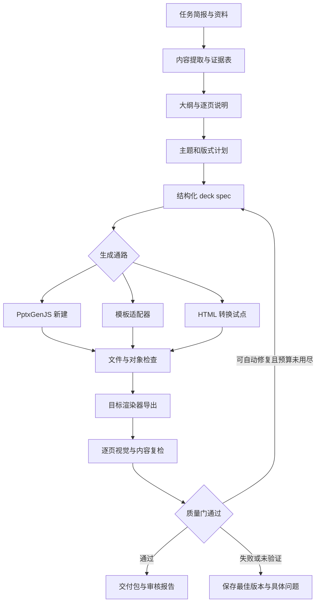

# 高质量 PPT Skill 与自动化工作流：开源选型及执行方案

研究日期：2026-10-13（北京时间）  
状态：供审核；本轮完成联网研究、源码核查和本地检查器探针，尚未安装候选项目或实施新生产工作流。

## 1. 建议审核的结论

**推荐先升级现有 `ppt-deck`，建设“结构化内容 → 版式组件 → 原生 PPTX → 可追溯验收”的本地工作流。新建以 PptxGenJS 为主，模板复用独立选型；HTML 转 PPTX 路线做对照试点。**

理由是本项目已有 Windows 渲染脚本、可编辑中文示例和字体度量基础，继续建设的迁移成本较低。真正缺少的是可信的检查覆盖、可靠编排、设计组件、内容证据和失败恢复。这是针对本目录的工程选择，不代表已通过实验证明某个项目视觉质量最高。

先做三个决策：

1. **一期范围**：Windows 本地、中文优先、8–20 页汇报/答辩/技术介绍、原生可编辑文本和常见图表。
2. **试点路线**：主线自有工作流；PPTAgent 当前 Skill 与 Slidev 可编辑导出各作一个小型对照。Presenton 在导出依赖审计完成后再加入。
3. **交付标准**：提供 PPTX、生成源、素材、预览、检查报告、来源表及编辑性清单；每个验证环节必须说明执行结果和未覆盖项。

无需一期同时搭建 Web 平台、MCP 服务、定时任务和多个生成引擎。先让单个任务从输入到交付可靠完成，再决定产品入口。

## 2. 研究方法与证据边界

三名子智能体分别研究生成/模板框架、Skill/网页幻灯片、QA/评估；主智能体核验关键结论并审核本地工具链。详细记录见本目录 `generation-research.md`、`skills-research.md`、`qa-research.md`。

统一采用以下证据标签：

| 标签 | 含义 | 可以支撑什么 |
|---|---|---|
| 本地实测 | 本轮运行命令或探针，保留输出 | 仅支撑已运行环境和样本 |
| 源码核查 | 读取特定源码、配置、测试或许可证 | 支撑“实现存在”，不能代替安装成功或质量实测 |
| 官方声明 | README、官方文档、作者论文 | 支撑项目宣称及设计，不直接作为本机验收结果 |
| 待试点 | 本轮未验证运行、效果或依赖完整性 | 必须经过后续试点才能用于交付承诺 |

不按 star 数排名，不把论文分数当作本项目实测，不把网页可视效果等同于 PowerPoint 打开后的效果。`main` 是可变化的引用；引入依赖前须登记实际 commit/tag、依赖锁文件和文件级许可证。第三方素材、字体、数据集和模型权重另行记录许可，不能由仓库代码许可推导。

## 3. 开源选型：各项目应该放在哪一层

### 3.1 原生生成与模板复用

| 项目 | 建议角色 | 核心理由与限制 | 证据 |
|---|---|---|---|
| PptxGenJS | 新建 PPTX 主引擎 | 原生文本、形状、图表、表格；不承担读入并编辑任意旧 PPTX。候选固定版本 4.0.1，仍需本机生成回归 | [发布页](https://github.com/gitbrent/PptxGenJS/releases)、[图表 API](https://gitbrent.github.io/PptxGenJS/docs/api-charts/) |
| python-pptx | 文件检查、受限模板修改 | 可打开已有文件并修改支持的对象；不是完整 PowerPoint 布局/渲染引擎，不能据此承诺所有对象保真 | [官方说明](https://python-pptx.readthedocs.io/en/latest/user/presentations.html) |
| pptx-automizer | 模板通路首选试点 | 用既有幻灯片/元素为素材，修改文本、图表等；用真实用户模板验证复制关系、母版、图表和组对象的保留 | [项目](https://github.com/singerla/pptx-automizer)、[图表测试](https://github.com/singerla/pptx-automizer/blob/main/__tests__/modify-chart-bubbles.test.ts) |
| Open XML SDK | 可选结构验证组件 | 提供 OOXML 操作与验证能力；增加 .NET 依赖，不纳入最小一期运行环境 | [源码仓库](https://github.com/dotnet/Open-XML-SDK) |

底层库解决对象生成/操作问题，高质量仍取决于上层内容、版式和验收。原生图表应保留数据编辑能力；改变一个数据点后要能更新图表，而不能只检查 `.pptx` 中存在 `chart1.xml`。

### 3.2 Skill 与完整工作流

| 项目 | 处理方式 | 实际价值与边界 |
|---|---|---|
| OpenAI slides（固定公开提交）/ JetBrains slides | 许可核验后按需复用 helper 与 QA 实现 | 找到 Apache-2.0 文件级许可；固定提交包含排版辅助函数。当前 `openai/skills/main/skills/.curated/slides` 读取为 404，不能宣称当前主分支仍可直接安装。来源：[固定目录](https://github.com/openai/skills/tree/e6afb0d74cc75d220df2faf3dd6c635c2dc6a108/skills/.curated/slides)、[许可](https://raw.githubusercontent.com/openai/skills/e6afb0d74cc75d220df2faf3dd6c635c2dc6a108/skills/.curated/slides/LICENSE.txt)、[JetBrains](https://github.com/JetBrains/skills/tree/main/slides) |
| PPTAgent | 最值得试点的完整 agent 工作流 | 当前主分支提供 Skill，论文复现用 v0.2.0 / v1.1.38；当前安装面向 Linux/WSL/macOS。要核查 HTML 预览与最终 PPTX 的独立评审、编辑性及转换器依赖。来源：[版本与安装说明](https://github.com/icip-cas/PPTAgent)、[Skill 入口](https://github.com/icip-cas/PPTAgent/blob/main/skills/pptagent/SKILL.md) |
| PPT Master | SVG → 原生对象的后备试点 | 根仓 MIT，实际有 DrawingML 编译模块；输入是受约束 SVG，并非任意 SVG 都可无损转换。提供 Windows 文档；原生形状图表不自动等于可改数据的 Office 图表。来源：[技术设计](https://github.com/hugohe3/ppt-master/blob/main/docs/technical-design.md)、[转换模块](https://github.com/hugohe3/ppt-master/blob/main/skills/ppt-master/scripts/svg_to_pptx/drawingml/converter.py) |
| MiniMax pptx-generator | 补充工作流参考 | 需要区分提示词中的示例代码和真正打包的可执行脚本，不能将二者都计为现成工具链。来源：[Skill](https://github.com/MiniMax-AI/skills/blob/main/skills/pptx-generator/SKILL.md) |
| Presenton | Web/API 候选，暂不作为一期底座 | 主仓有 Apache-2.0，但导出核心由另一个 Release 包下载；本轮未取得该包内部源码及文件级许可证据。因此“完整链路开源且可审计”仍待确认，不据此断言组件闭源。来源：[主仓许可](https://github.com/presenton/presenton/blob/main/LICENSE)、[下载脚本](https://github.com/presenton/presenton/blob/main/scripts/sync-presentation-export.cjs)、[导出仓库](https://github.com/presenton/presenton-export) |
| Anthropic pptx | 比较对象，不复制到自有 Skill | 文件级许可证含复制和衍生限制，不能按仓库根目录许可当作可自由复用开源代码。来源：[pptx 文件级许可证](https://github.com/anthropics/skills/blob/main/skills/pptx/LICENSE.txt) |

PPTAgent 的值得借鉴之处是任务状态、转换后复检和可保存的评审结果；本地主线不需要照搬其安装方式或绑定其推荐模型。

### 3.3 Markdown / HTML 路线

| 项目 | 事实 | 在本方案中的用途 |
|---|---|---|
| Slidev | 常规 PPTX 为整页图片；新增 `pptx-editable` 用浏览器测量后重建对象，复杂元素图片化，个别页面可能整页回退 | 技术分享/网页演示的对照引擎，必须生成逐页回退清单。来源：[官方导出说明](https://sli.dev/guide/exporting) |
| Marp CLI | 常规 PPTX 为图片；实验性 `--pptx-editable` 需要浏览器和 LibreOffice，官方说明存在保真损失和备注限制 | 简洁 Markdown 演示及 PDF 出版对照，不作为原生复杂图表主线。来源：[官方导出说明](https://github.com/marp-team/marp-cli#powerpoint-pptx) |
| Frontend Slides | MIT 的 HTML 演示 Skill，提供真实风格预览；PDF 出口以截图生成 | 借鉴样页选型和设计合同，不视为已有原生 PPTX 引擎。来源：[Skill](https://github.com/zarazhangrui/frontend-slides/blob/main/plugins/frontend-slides/skills/frontend-slides/SKILL.md)、[PDF 脚本](https://github.com/zarazhangrui/frontend-slides/blob/main/plugins/frontend-slides/skills/frontend-slides/scripts/export-pdf.sh) |

网页路线能提高 CSS 设计效率；转回 PPTX 后要重新检查中文换行、字体、表格和图表。在浏览器中能编辑源代码，不等同于在 PowerPoint 中能逐对象编辑。

### 3.4 开源评估项目：分别借用方法

| 项目 | 适合借用 | 不能据此推导 |
|---|---|---|
| PPTAgent / PPTEval（v0.2.0） | 内容、设计、整套连贯性分开评价 | 新版 Skill 已获得旧论文同样成绩。来源：[论文](https://arxiv.org/abs/2501.03936) |
| PPTBench-Eval（Gastronomicluna，2512.02624） | 检测、理解、修改、生成四类任务覆盖；代码 MIT | 空间操作成绩等同完整中文汇报质量。来源：[仓库](https://github.com/Gastronomicluna/PPTBench-Eval) |
| PPTBench（Einsia，2609.29718） | 科学图重建的硬门禁、问题定位、由代码确定扣分；代码 MIT，资料许可另分层 | 单页图重建评分可以原样用于整套叙事。来源：[评估协议](https://github.com/Einsia/PPTBench/blob/main/docs/evaluation.md)、[数据许可](https://github.com/Einsia/PPTBench/blob/main/DATA_LICENSE.md) |
| PresentBench | 按原资料生成任务清单、二元验收、断点续跑；代码 Apache-2.0 | PDF 评审通过就能证明 PPTX 对象可编辑。来源：[仓库](https://github.com/PresentBench/PresentBench)、[judge 实现](https://github.com/PresentBench/PresentBench/blob/main/judge.py) |

两个 PPTBench 是不同项目，不合并样本数或成绩。SlideBench.org 本轮页面仍显示 GitHub coming soon，因此作为方法参考，不列为已核到实现的开源依赖。外部评估集只择取适配的方法；一期用自有、可合法复现的中文测试集。具体材料与论文证据见 `qa-research.md`。

## 4. 当前文件夹的核查结论

原有“叙事 → 生成 → 验证”方向保留。需要修正的是覆盖声明和工程可靠性。

### 4.1 本轮实际运行

环境：Python 3.12.4、Node 24.11.1、python-pptx 1.0.2、Pillow 11.3.0、fonttools 4.59.2、lxml 6.0.2。当前目录无法解析 `pptxgenjs/package.json`；这说明未确认生成器依赖就绪，不能由保存的成品推断当前可以重建。注册表存在 PowerPoint COM 注册，本轮未启动 PowerPoint，也未重新渲染。

已有 `demo-zh.pptx`：10 页，静态检查 0 error / 0 warning；结构检查通过并识别 1 个图表。`skill/scripts` 五个文件与 `02-工具链` 的对应文件内容一致。

新增独立探针脚本 `local_audit.py`，结果保存到 `本地核查证据/audit-results.json`：

| 探针 | 实测结果 | 能证明什么 |
|---|---|---|
| 纯矩形起始 x=14in，画布宽 13.333in | 0 issues | 当前越界检查未覆盖非文字对象 |
| 组合内文本框在画布外 | 0 issues | 未递归覆盖组对象 |
| 单个 120 字符长词置于 1in 宽框 | 0 issues | 模型缺少超宽 token 检查；本轮未渲染，不声明 PowerPoint 的实际断行结果 |
| 默认继承背景的 python-pptx 页面 | 抛出 `_NoFill` TypeError | 合法常见背景模式可让检查器异常退出 |
| 人工 ZIP 中轴引用 999，声明只有 1 | `check` 返回 0 | 轴引用一致性没有完整检查；该 ZIP 只是检查器单元探针，不是完整可打开 PPTX |

### 4.2 源码核查，尚未逐项运行

1. `deck_tools.py` 的 LibreOffice 分支找不到 `pdftoppm` 时仍返回 0；忽略 PNG 转换的退出码，未验证输出页数与新鲜度。
2. 当前检查主要面向文本框；主题色、背景继承、组内坐标、表格文字和图表标签覆盖不完整。
3. 缺失字形的文档说会标记近似，代码没有将字形缺失传播到 `approx`；不能仅凭字体已安装就称度量精确。
4. `spcAft` 读取路径与 OOXML 子元素结构不一致；部分行距/段距模型会低估内容高度。
5. 代码硬底线为 8pt，文档多处写 9pt；投影展示正文阈值尚未真正按角色执行。
6. `dump` 遍历对象顺序，没有建立视觉阅读顺序；`balance_check` 的整页像素统计不能普遍表示正文内容带，页脚、图像和背景图会影响结果。
7. 示例居中函数使用 PptxGenJS 私有 `_slideObjects`，且 `maxY` 只取对象顶部，没有加高度；必须改成自有场景数据计算边界。
8. 示例源内容本身存在口径冲突：同一报告耗时分别写“40 分钟→1 分钟”和“0.9 秒”，而 0.9 秒 KPI 的说明仍为“提速 40 倍”。除非明确区分端到端流程与某个计算环节，否则这三项不一致。没有原始业务资料，不能选择其中某项作为事实；应标记示例数据并统一口径。内容验收必须与几何验收同等重要。

现有 `04-校准证据/lint.json` 还保留历史误报和旧目录路径；它说明实验做过，不能作为当前源码版本的完整回归记录。后续要关联源码、字体、渲染器与产物 hash。

这些问题应在一期处理，并以明确的“未覆盖”报告替代静默跳过。报告中的约 1% 校准误差保留为历史单探针结果；新基准需要多字体、多字号、混排与不同布局才能得出新的误差分布。

## 5. 工作流设计：把 Skill 和程序职责分开

### 5.1 Skill 的职责

Skill 写清任务入口、叙事组织、证据使用、版式选择、质量门、修复策略和交付标准。它调用脚本，不在提示词里假装脚本不存在的功能已经可用。

按任务分三条路线：新建、模板填充/受限编辑、现有 PPT 审核。正文规则按展示型和阅读型分开。封面、目录、章节页可用简短主题词；内容页优先用表达结论的标题。“禁止米色、禁止色条”等历史偏好降为可配置风格规则，不能伪装成质量标准。

用户审核的是具体大纲与设计样页；已授权自动完成的任务可用已确定的默认值继续。缺少会改变任务目标的资料时请求补充，不因每次局部排版修复重新确认。

资料入口先支持文本/Markdown、结构化 JSON 数据和 PPTX 现有提取；Office/PDF 扩展可选 MIT 的 [MarkItDown](https://github.com/microsoft/markitdown)。提取结果作为索引，保留原文定位；图片文字/复杂表格单独核查。不要将 Markdown 转换当作版式还原或完整事实校验。

### 5.2 程序的职责



**结构化 deck spec** 是内容与引擎之间的接口。每页含 `slide_id`、目标结论、证据 ID、版式类型、标题/正文/图表数据、notes；每个元素含稳定 ID、类型、语义角色、坐标、组关系、编辑性需求。先仅支持受控组件，不建设万能绘图语言。

设计主题最少包含：字体栈、角色字号、间距、页边距、颜色、图表配色和背景；采用独立布局组件，避免模型每页随意造坐标。

一期版式：封面、结论页、KPI、左右对比、图表+结论、流程、时间线、带注释表格、章节页、结尾请求。选三套主题：学术简洁、商务汇报、技术分享。一个任务选一套；图标选同一家族，有意义才添加。示意图与实证图在来源表中区分。

### 5.3 文件与状态

拟实施目录（以下为设计，尚未创建为生产工具）：

```text
ppt-workflow/
  skill/SKILL.md
  schemas/brief.schema.json, deck.schema.json, qa.schema.json
  themes/academic.json, business.json, technical.json
  layouts/                    # 原生组件
  adapters/native/, template/, html-pilot/
  qa/package_check.py, geometry.py, typography.py, content.py
  render/windows.ps1, libreoffice.py
  orchestrator/               # 状态、产物、重试、交付
  tests/fixtures/, benchmark/
  THIRD_PARTY_NOTICES.md
  package.json, package-lock.json, requirements.lock.txt
  runs/<job-id>/<revision>/
```

每次运行保存输入 hash、spec hash、引擎版本、渲染器版本、字体列表、PPTX hash、预览路径、QA 结果、模型调用数量/耗时。正式依赖版本在试点通过后固定，不能让安装命令一直跟随 `latest`。

状态机：`brief_ready → outline_ready → design_ready → built → static_checked → rendered → reviewed → delivered`；异常区分 `failed`、`needs_review`、`unverified`。同一页修复后重跑静态检查并重渲染；最后一次交付前整套渲染/检查一次。没有图或未审核不能标记 `delivered`。配置接口草案见 `方案配置示例.json`，这是审核合同，尚无生产程序读取它。

## 6. 质量门：哪些必须通过，哪些需要判断

| 门 | 自动检查 | 人/视觉检查 | 失败处理 |
|---|---|---|---|
| 内容 | 标题/正文覆盖、数值/单位/日期对照证据表、notes/来源存在 | 论证、取舍、是否误导 | 无证据数字退回内容，不靠设计掩盖 |
| 结构 | ZIP/XML 可读、内部关系目标、chart axis 引用、媒体、页数 | PowerPoint 打开无修复提示 | 阻止发布，修生成器 |
| 几何/文字 | 所有对象及组变换、表格单元格、越界、碰撞、字体/字形、段距、超宽词 | 中文禁则、孤字、图表轴标签 | 缩文/改版式/拆页，最后才在允许范围调字号 |
| 渲染 | 退出码、PNG 页数、尺寸、文件 hash/时间、缺页、空白异常 | 输出可读、视觉重心、风格一致、裁切 | 不允许旧图片冒充新结果 |
| 编辑性 | 文本/图表/表格等对象类型与需求一致，图片回退登记 | 改标题、改图表数据、改表格值并复看 | 不满足要求时阻止“可编辑”交付声明 |
| 总体 | 未关闭 issue、失败页、预算、manifest | 叙事节奏、密度、投影阅读距离 | 超过预算交审核版和问题表 |

### 6.1 初始阈值属于产品策略

展示型建议标题 28–40pt、正文 18–24pt、图表标签 ≥14pt、来源 ≥10pt；阅读型可更密，但要单独定义。此处是待审核的初始策略，不是公认唯一正确值。

文字对比度按 4.5:1；大字按 3:1，同时考虑 14pt 粗体的例外。原代码只以 18pt 为分界不完整。文字背景要考虑实际填充、层级和透明度；图像背景交视觉检查。WCAG 是网页无障碍标准，这里明确作为可读性参考，不宣称 PPT 已取得合规认证。[W3C 对比度解释](https://www.w3.org/WAI/WCAG22/Understanding/contrast-minimum.html)

正文高度、留白比例只作提示，不能“底部超过 30% 就失败”。章节页与内容页分别评估。禁止隐式自动缩小文本通过验收；长词/URL 可以换行、缩短展示文字或放到备注。

每个 issue 返回：`slide_id`、`element_id`、rule、severity、bbox、证据截图、建议修复和 confidence。未知情况返回 `unverified`，不等于 pass。

### 6.2 PowerPoint 的边界测量

增加可选 COM 测量器，读取 `TextRange.BoundLeft/Top/Width/Height` 并对照文本框；这比仅预测字体行高更贴近本机排版结果。还须校准内边距、旋转、组变换和文本效果，不能简单以 `BoundHeight > shape.Height` 覆盖所有情况。[BoundHeight](https://learn.microsoft.com/en-us/office/vba/api/powerpoint.textrange.boundheight)、[BoundWidth](https://learn.microsoft.com/en-us/office/vba/api/powerpoint.textrange.boundwidth)

静态估计保留为快速预检，字体度量误差用分布报告：行数吻合率、绝对高度误差、P50/P95、溢出召回与误报率，分语言和字体报告。

### 6.3 有限修复，而不是无限重试

建议初次生成后最多 2 轮修复：第 1 轮确定性缺陷，第 2 轮视觉/断行，随后整套复验。复验不通过就交审核版，不再开启第 3 轮重写。每轮保存版本、issue 和差异；不得擅自修改数据、来源、关键论点或模板品牌元素。基础设施重试与内容修复分开计数，默认渲染环境故障最多重试 1 次，视觉调用失败最多 3 次含初次；失败保持未验证状态。

生成与评审使用分开的调用，评审只看 brief、spec、来源和画面，不读生成模型的自我解释。有争议时交给人，不用平均分覆盖严重缺陷。视觉模型评分是辅助证据；相同模型多次评审也不能视为独立裁判。

## 7. 桌面与服务器：两种渲染部署

本机一期采用登录用户的 Windows 桌面 worker，串行访问 PowerPoint。渲染器应在 `finally` 清理自身打开的 presentation 和 COM 引用，加任务超时与输出验证。不要通过全局 `taskkill POWERPNT` 结束用户正在编辑的文件；COM 实例可能共享进程，必须确认所有权，无法确认时标记人工处理。

COM 是付费 Office 的运行依赖，本方案生成/QA 代码可以开放，并不意味着运行环境全开源。若要求完全开源，则改走 LibreOffice，但必须单独测试 PowerPoint/WPS 的目标显示效果。

后续服务器批量任务用隔离的 LibreOffice/浏览器 worker，不把桌面 COM 直接部署成无交互 Windows 服务。Microsoft 明确不支持无人值守、非交互服务中的 Office 自动化；这直接限制架构选择。[Microsoft 部署说明](https://support.microsoft.com/en-us/visio/considerations-for-server-side-automation-of-office)

跨平台不能只改渲染入口；还须替换 Windows-only 字体发现路径、记录字体许可和替代情况。

## 8. 实施计划与验收

估算：一名实现者约 7–10 个工作日完成一期和小型对照；模板复杂性可能增加时间。以下是工程估计，不是性能实测或交付日期承诺。

| 阶段 | 工作 | 交付 | 通过条件 | 估算 |
|---|---|---|---|---|
| P0 环境/证据冻结 | 固定候选版本、许可证、依赖、字体与历史基线；确定输入/QA schema | 依赖与来源清单、复现实验记录 | 当前示例可重新生成；记录真实缺项 | 0.5–1 日 |
| P1 修复验收基础 | 修背景异常、非文字越界、组变换、段距/缺字形、chart references、渲染返回码/输出验证 | QA v2、正负例 fixtures | 本轮明确缺陷均正确报告；正常例无回归 | 1.5–2 日 |
| P2 设计与内容接口 | brief/spec、主题、10 类布局、来源表、原生图表数据映射 | 组件与样页 | 3 套主题样页；目标正文阅读尺度通过 | 1.5–2 日 |
| P3 编排/Skill | CLI、manifest、断点续跑、最多2轮修复、来源/编辑性验收、任务路由 | 自有 Skill v2、运行入口 | 一次命令可完成已确定 spec 的构建/QA；失败不会假报成功 | 1–1.5 日 |
| P4 对照试点 | 自有主线、PPTAgent、Slidev，同一资料与设计约束；模板通路跑真实模板 | 对照数据及选型确认 | 收集质量/编辑性/成本；无预设赢家 | 1–1.5 日 |
| P5 交付固化 | 示例、安装文档、完整自检、样例修订和发行包 | 可安装 Skill 与完整示例包 | clean 环境可复现；用户审核样例 | 1–2 日 |

### 8.1 测试材料

首批 6 个完整任务，每套约 8–12 页：中文答辩、中文商务报告、中英混排技术介绍、真实学院模板、表格密集资料、从现有 PPT 修改内容。统一提供原始事实/数据、目标受众、页数和必须可编辑元素。

另建至少 24 个小型正负例：中英/数字混排、标点/URL、字体缺失/缺字形、段前段后/固定行距、表格、组缩放/旋转、继承背景/主题色、图表双轴关系、越界/有意重叠、缺图/旧图。正负例成对保留，避免只会报错却无法识别正常页。

初筛三个通路各跑一套；通过依赖、许可及基本编辑性门后，两个入选通路先在两套共同任务上各跑 3 次，共 12 次对照；主线另完成全部六类任务验收。扩大到完整共同测试集是后续步骤，先依据初筛耗时和调用费用决定。unsupported 单列，不塞入平均分，也不只选某个引擎擅长的样本。阈值校准样本与最终留出样本分开，不能在同一页调参后声称泛化。

### 8.2 对照指标和晋级标准

所有数字是拟定验收目标，尚未测得：

| 指标 | 记录方法 | 一期建议门槛 |
|---|---|---|
| 事实与关键数字 | 对照证据表逐项检查 | 必须正确，示例数据明确标注 |
| 文件和渲染成功 | 成功任务数/总数、缺页、修复提示 | 验收集 100% 成功或明确失败，无假成功 |
| 受控缺陷覆盖 | 按 rule 报召回、误报 | 一期已支持的确定性负例全检出；未支持显式报告 |
| 编辑性 | 逐对象 manifest + 实际修改验证 | 要求可编辑的文本/图表/表格全部满足 |
| 视觉质量 | 双人盲评：阅读、层级、对齐、图表、节奏各1–5分 | 中位数≥4，任何严重缺陷仍失败 |
| 自动化收益 | 人工修改分钟数、修复轮数 | 与当前工作流同材料对比，不能只报生成速度 |
| 成本/速度 | 单独记录生成、渲染、评审耗时及模型调用 | 完成试点后设置现实上限 |

若不具备双人评审条件，用“一人盲评 + 明确案例截图”并标注证据较弱。评估集必须包含最终 PPTX 的重新渲染，而不仅是 HTML 截图。

## 9. 可以运行的核查与拟实现命令

### 9.1 本轮已有可运行命令

在项目根目录运行（只读取原始 PPT，探针输出写入研究目录）：

```powershell
python .\02-工具链\deck_lint.py .\03-示例与验收\demo-zh.pptx --quiet
python .\02-工具链\deck_tools.py check .\03-示例与验收\demo-zh.pptx
python .\05-开源项目深度研究\local_audit.py
```

`local_audit.py` 记录当前缺口；脚本 exit 0 表示实验执行完成，不表示旧检查器已修复。

### 9.2 审核后拟实现的接口

下列是目标 CLI 契约，当前不存在这些生产命令：

```powershell
python -m ppt_workflow doctor
python -m ppt_workflow plan --brief jobs/demo/brief.json
python -m ppt_workflow build --spec jobs/demo/deck.json --engine native
python -m ppt_workflow qa --job demo --renderer powerpoint
python -m ppt_workflow revise --job demo --issues runs/demo/qa.json
python -m ppt_workflow deliver --job demo
python -m ppt_workflow benchmark --suite benchmark/suite.json
```

`doctor` 检查依赖/字体/渲染器；`plan` 生成审核材料；`build` 从确定 spec 生成；`qa` 产生机器与视觉结果；`deliver` 只打包满足质量门的版本。依赖或视觉能力不足时 `qa` 返回非成功状态，不替用户猜测通过。

安装候选 PptxGenJS 使用明确版本 `npm install --save-exact pptxgenjs@4.0.1` 并保存 lockfile；本轮没有执行。PPTAgent、Slidev 与模板适配器在隔离试点目录安装，依据其固定版本实际文档建立环境，不直接把 Linux 命令复制到 Windows PowerShell。

## 10. 交付与本次审核点

一次正式 PPT 交付至少含：`deck.pptx`、`deck.spec.json`、生成源、必要素材、逐页 PNG、接触表、`qa.json`、`review.md`、`sources.json`、`editability.json`、`manifest.json`。PDF 为可选项。来源应区分真实数据、估算、示意和生成图片。

本次建议用户确认：

- 是否按“现有 Skill 升级 + 原生 PPTX 主线”实施；
- 是否接受 Windows+PowerPoint 作为一期运行环境，完全开源部署放到后续；
- 是否采用正文 18–24pt、原生常见图表/表格作为展示型交付底线；
- 是否先做 P0–P3，再由共同材料的对照试点决定是否引入其他引擎；
- 是否把模板适配加入一期，或先完成新建通路。

这是可拆解执行的审核稿，不是“全部候选项目已跑通”的报告。原始研究、Skill、脚本和示例保留；本轮只新增研究资料与核查证据。
